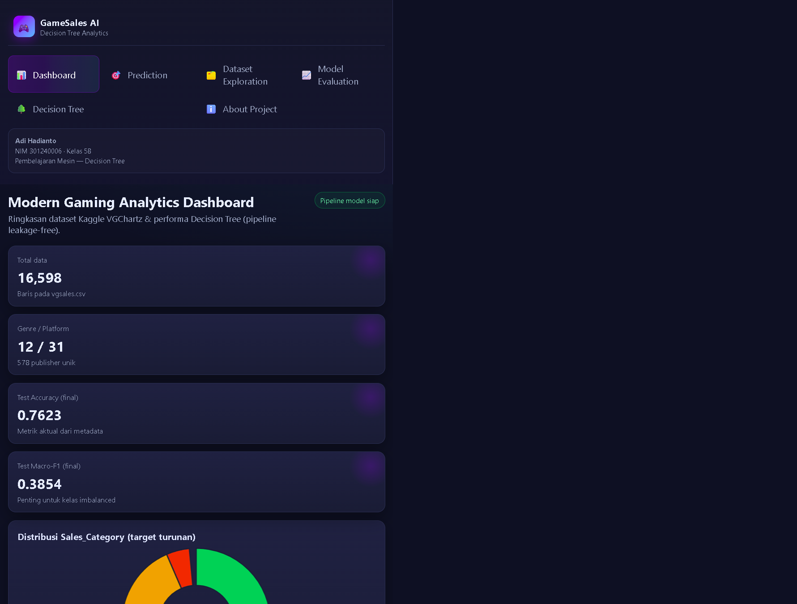
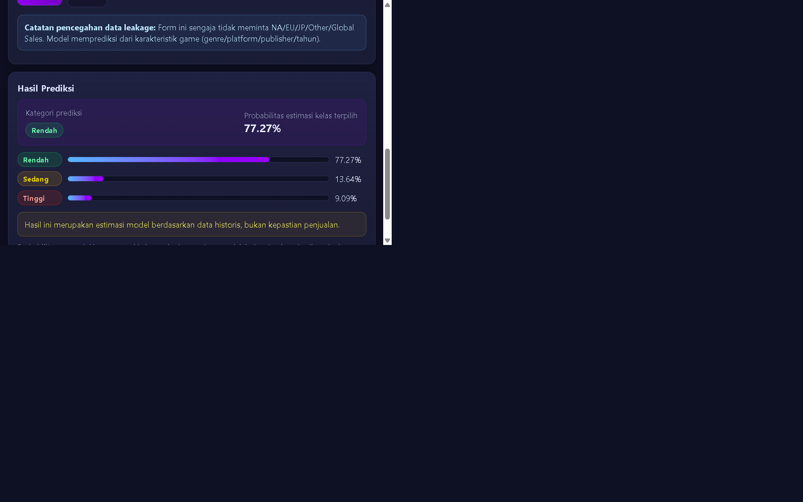
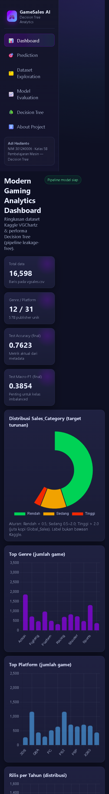

# Laporan Evaluasi — Prediksi Penjualan Video Game

Tanggal audit: 9 November 2026
Status: audit awal, perbaikan bertahap, retraining, dan retest selesai.
Lingkup: aplikasi lokal pada `http://127.0.0.1:5000`, sesuai `VIBE_CODING_RULES_TA_Decision_Tree.md`. Identitas proyek, sumber dataset, ambang target, fitur, Decision Tree Gini, dan rancangan dashboard dipertahankan.

## Ringkasan eksekutif

Aplikasi dan artefak awal dapat dijalankan, tetapi audit menemukan kesalahan label pada batas target yang eksplisit: 71 baris dengan `Global_Sales == 0.5` diberi label Rendah, bukan Sedang. Perbaikan batas ini diterapkan lalu model dilatih ulang. Selain itu, validasi tahun, kategori input yang bisa diketik, kesalahan dataset/model, reset form, metrik dokumentasi, dan konteks JSON pada grafik diperbaiki.

Semua halaman utama, prediksi, paginasi, zoom/unduh pohon, status data/model hilang, dan tampilan desktop/tablet/ponsel diuji ulang. Tidak ada perubahan metodologi atau fitur model selain koreksi label sesuai ambang yang sudah ditetapkan.

## 1. Kondisi awal dan bukti

- Server Flask berjalan pada `127.0.0.1`, `debug=False`; health awal mengembalikan `model_ready=true`.
- Dashboard, Prediction, Dataset, Evaluation, Decision Tree, About menghasilkan HTTP 200; rute tidak dikenal menghasilkan 404.
- Dataset aktual berisi 16.598 baris × 11 kolom sumber, missing `Year=271`, `Publisher=58`, duplikat 0.
- Pipeline awal memakai `Platform`, `Genre`, `Publisher`, `Year`; kolom penjualan, `Rank`, dan `Name` tidak dipakai sebagai fitur. Preprocessing berada dalam pipeline; encoder di-fit saat training; kategori baru tidak menyebabkan crash.
- Model awal tersimpan: `DecisionTreeClassifier(criterion="gini")`, depth 8, `min_samples_split=2`, `min_samples_leaf=1`, `ccp_alpha=0.0`, split stratified 80:20 (`random_state=42`).
- Uji awal menemukan tahun pecahan `2015.6` diterima dan dibulatkan menjadi 2016.
- Uji batas awal: `0.499999 → Rendah`, `0.5 → Rendah`, `0.500001 → Sedang`, `2.0 → Sedang`, `2.000001 → Tinggi`. Ada 71 baris bernilai tepat 0,5.
- Angka metadata awal final (test): accuracy 0,76898; weighted precision 0,70827; weighted recall 0,76898; weighted F1 0,70962; macro-F1 0,39795; recall kelas Tinggi 0,06509.
- README awal menampilkan angka weighted precision/F1 yang berbeda dari metadata aktual.
- Screenshot dashboard kondisi awal terlihat pada sesi audit. Screenshot awal tersebut tidak tersimpan sebagai PNG; screenshot sesudah perbaikan dan hasil uji dicatat di folder bukti.

## 2. Pengujian dari sudut pandang pengguna

| Alur | Pengujian | Hasil retest |
|---|---|---|
| Pengguna baru | Membuka dashboard, membaca KPI/aturan kategori, mengikuti enam tautan navigasi | Lulus; semua menu membuka halaman sesuai judul |
| Dataset/EDA | Membaca ringkasan, grafik, tabel, Next dan Prev | Lulus; 25 baris/halaman; page 2 dan kembali ke page 1 |
| Training | Menjalankan `python train_model.py` dari terminal sesuai README | Lulus; audit, split, baseline, eksperimen pruning, evaluasi, visualisasi, dan artefak tersimpan. Training bukan tombol di UI web. |
| Evaluasi | Membuka metrik, confusion matrix, classification report, tabel pruning | Lulus; matrix 3×3 dan laporan per kelas ditampilkan |
| Pohon | Memuat visualisasi, klik zoom dua arah, mengambil tautan unduhan | Lulus; PNG dimuat (3.626 px lebar), zoom toggle bekerja, unduhan HTTP 200 |
| Prediksi valid | Mengirim Platform/Genre/Publisher yang dikenal dan Year integer | Lulus; kategori, tiga probabilitas, input, dan disclaimer ditampilkan |
| Kategori baru | Mengetik Platform, Genre, dan Publisher baru | Lulus; model merespons tanpa crash; input baru kini dapat diketik lewat field dengan saran |
| Input tidak valid | Kosong, tahun bukan angka/NaN, di luar 1970–2035, tahun pecahan | Lulus setelah perbaikan; pesan validasi tampil, tahun pecahan ditolak |
| Reset | Reset setelah hasil tampil | Lulus; kembali ke form kosong dan hasil sebelumnya hilang |
| File model/dataset hilang | Uji terisolasi dengan direktori sementara | Lulus; health berstatus `degraded`, sebab ditampilkan di halaman, pesan dicatat di log |
| Keamanan input | Input HTML/script pada field dan payload chart JSON terkontrol | Lulus; teks input di-escape, JSON script memakai `tojson`, string uji tidak menjadi elemen script |
| Performa | 50 prediksi service dan 20 GET form, interpreter/workstation audit | Median prediksi 15,372 ms (P95 18,499 ms); GET form median 11,423 ms (P95 13,346 ms; maksimum 100,325 ms termasuk warm-up) |

Chart.js termuat dan membuat empat chart dashboard; tidak ada page error JavaScript pada pemeriksaan responsive. Missing dataset/model diuji di direktori sementara, bukan dengan menghapus file proyek.

## 3. Temuan UI/UX, backend, keamanan, dan ML

| Prioritas | Severity | Temuan awal | Perbaikan/status |
|---:|---|---|---|
| 1 | High | Batas 0,5 juta salah label; 71 baris masuk Rendah, tidak sesuai aturan Sedang untuk 0,5–2,0. | **Diperbaiki.** Nilai tepat 0,5 kini Sedang; pipeline dilatih ulang. |
| 2 | High (residual) | Recall kelas Tinggi sangat rendah karena imbalance dan fitur karakteristik terbatas. | **Belum diubah.** Recall test final setelah koreksi label 0,02959. Perubahan seperti class weighting/strategi lain dapat mengubah metodologi dan perlu persetujuan akademik. |
| 3 | Medium | Tahun pecahan dibulatkan diam-diam; UI meminta tahun rilis bulat. | **Diperbaiki.** Server menolak nilai pecahan dan hanya menerima integer dalam rentang 1970–2035. |
| 4 | Medium | Pilihan Publisher berupa daftar 578 item; kategori baru tidak dapat diketik dari UI walaupun backend mendukungnya. | **Diperbaiki.** Platform/Genre/Publisher menjadi input dengan datalist, sehingga bisa dicari atau diketik bebas. |
| 5 | Medium | Kegagalan dataset diubah menjadi `None` tanpa pesan UI/health yang memadai. | **Diperbaiki.** Error dicatat, halaman menampilkan instruksi, health menyebut `dataset_ready` dan status degraded. |
| 6 | Medium | JSON grafik disisipkan memakai `json.dumps` + `safe`, berisiko keluar dari konteks script jika nilai dataset berisi markup. | **Diperbaiki.** Template memakai filter Jinja `tojson`; uji string `</script><script>…` ter-escape. |
| 7 | Medium | README tidak cocok dengan metadata untuk weighted precision/F1 dan distribusi target. | **Diperbaiki.** README memakai hasil artefak training aktual. |
| 8 | Low | Secret key Flask fallback berupa konstanta di source. | **Diperbaiki.** Memakai environment variable bila tersedia, jika tidak memakai secret acak per proses. |
| 9 | Low | Reset form dapat menyisakan hasil lama setelah input dikosongkan. | **Diperbaiki.** Reset menjadi tautan GET ke form prediksi kosong. |
| 10 | Low (rekomendasi) | Label menu sebagian berbahasa Inggris sedangkan mayoritas penjelasan berbahasa Indonesia. | Dibiarkan untuk mempertahankan identitas/desain; pertimbangkan konsistensi bahasa pada iterasi UI berikutnya. |
| 11 | Low (rekomendasi) | Training hanya bisa dijalankan melalui CLI, tidak tersedia sebagai aksi dashboard. | Alur terdokumentasi dan diuji melalui `python train_model.py`; tidak ditambahkan endpoint training agar training eksplisit dan tidak mengubah alur akademik/operasional. |

## 4. Audit ML dan hasil sebelum–sesudah

Aturan target yang diterapkan: Rendah `<0.5`; Sedang `0.5 ≤ Global_Sales ≤ 2.0`; Tinggi `>2.0` juta kopi. Pipeline final tetap menggunakan fitur `Platform`, `Genre`, `Publisher`, `Year`; imputer median untuk Year, konstanta `Unknown` untuk Publisher, One-Hot dengan `handle_unknown="ignore"`, dan Decision Tree Gini ter-pruning. Split, parameter pruning, metrik, confusion matrix, classification report, dan model tersimpan tetap tersedia.

| Ukuran final pada test | Sebelum (label lama) | Sesudah (label dikoreksi) |
|---|---:|---:|
| Accuracy | 0,76898 | 0,76235 |
| Weighted precision | 0,70827 | 0,69572 |
| Weighted recall | 0,76898 | 0,76235 |
| Weighted F1 | 0,70962 | 0,70567 |
| Macro-F1 | 0,39795 | 0,38543 |
| Recall kelas Tinggi | 0,06509 | 0,02959 |
| Target Rendah seluruh dataset | 12.651 (76,22%) | 12.580 (75,79%) |
| Target Sedang seluruh dataset | 3.101 (18,68%) | 3.172 (19,11%) |
| Target Tinggi seluruh dataset | 846 (5,10%) | 846 (5,10%) |

Penurunan metrik sesudah koreksi dicatat apa adanya; model tidak disetel untuk menutupi dampak koreksi target. Model final baru dan `model_metadata.json` tersimpan, memakai konfigurasi `depth_8` yang sama. Pada test baru, confusion matrix final adalah `[[2424,85,7],[526,102,7],[117,47,5]]`; recall kelas Tinggi hanya 5 dari 169 kasus. Ini batasan penting untuk interpretasi pengguna, bukan alasan untuk menyebut hasil “akurat” bagi kelas Tinggi.

## 5. Retest responsivitas dan operasional

Ukuran viewport yang diperiksa: desktop 1440×900, tablet 900×1024, ponsel 390×844.

- Dashboard dan form prediksi tidak memiliki horizontal overflow pada ketiga ukuran.
- Form berubah dari dua kolom pada desktop/tablet menjadi satu kolom pada ponsel.
- Dashboard membentuk empat chart pada ketiga ukuran.
- Paginasi Next/Prev, reset, menu navigasi, zoom pohon, dan unduhan PNG diuji melalui browser.
- `/api/health` setelah training: `status=ok`, `model_ready=true`, `dataset_ready=true`.
- Ketika model atau dataset sengaja tidak tersedia di direktori uji, halaman tetap dapat dirender dan health menjadi `degraded`; tidak ada fallback sukses palsu.
- Flask dijalankan lokal dengan `debug=False` dan bind `127.0.0.1`. Belum ada audit deployment production, autentikasi, atau CSRF karena aplikasi saat ini berupa demo lokal tanpa akun/session.

## 6. Bukti screenshot dan log

PNG berikut berasal dari browser aplikasi yang berjalan:

Screenshot halaman Dataset, Evaluation, Tree, dan About juga tersimpan pada folder yang sama. Ringkasan perintah dan hasil uji tersimpan di [evaluation-test-log.txt](./evaluation-test-log.txt).

## 7. Rekomendasi

1. Jangan menafsirkan accuracy sebagai performa kelas Tinggi; tampilkan/tekankan recall 0,02959 dan dukungan test 169 saat presentasi.
2. Jika ingin mengatasi imbalance, minta persetujuan dosen/pemilik metodologi lebih dahulu; dokumentasikan perubahan, ulangi eksperimen dengan prosedur evaluasi yang disetujui, dan jangan mengganti hasil saat ini diam-diam.
3. Pertahankan pesan batasan prediksi dan transparansi bahwa probabilitas pohon bukan jaminan penjualan.
4. Jika aplikasi akan dipublikasikan di luar localhost, gunakan server WSGI production, secret terkelola, dan perlindungan CSRF serta cookie sesuai kebutuhan deployment.
